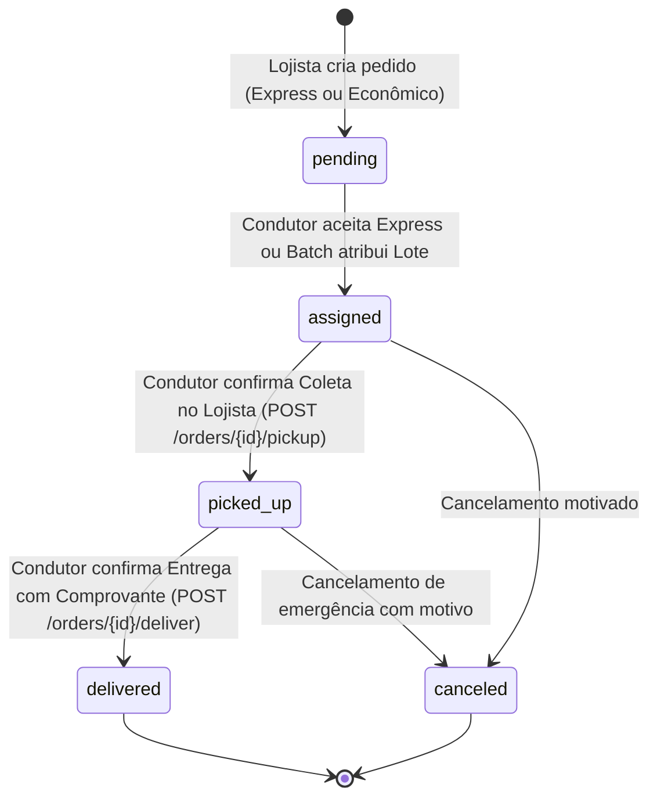

# SPRINT 6: Execução Operacional de Rotas, Atualização de Status e Transbordamento GPS

- **Período**: 14/10/2026 a 22/10/2026 (9 dias)
- **Branch Git**: `sprint/6-execucao-rotas-status-navegacao`
- **Requisitos Mapeados**:
  - **RF 08**: Painel / Agenda de Tarefas do Entregador (Must Have, RICE 2000)
  - **RF 09**: Atualização Manual de Status do Ciclo de Vida do Pedido (Must Have, RICE 6000)
  - **RF 12**: Transbordamento para Navegação Externa (Google Maps / Waze) (Could Have, RICE 2000)
  - **RNF 01**: Persistência Geoespacial e Integridade Transacional (PostgreSQL/PostGIS)
  - **RNF 03**: Compatibilidade Multiplataforma (Expo SDK 54 / Expo Go)

---

## 1. Objetivos da Sprint

Consolidar a experiência operacional em campo para o **Entregador Parceiro** e o rastreamento transparente em tempo real para o **Lojista**, viabilizando a execução física dos trajetos planejados nas sprints anteriores.

A Sprint 6 integra três pilares essenciais:
1. **Agenda de Rotas Sequenciadas (`(courier)/route-agenda`)**: Apresenta a jornada de entregas (lote econômico agrupado ou entrega expressa) através de uma lista vertical ordenada cronologicamente (Pickup & Delivery Problem), com destaque dinâmico para a *parada atual em atendimento*, métricas de progresso e estimativa de ganhos consolidados (frete base + taxa de parada R$ 3,00 + bônus de rateio).
2. **Máquina de Estados Estrita & Comprovante de Entrega**: Garante que as transições de status (`pending` $\rightarrow$ `assigned` $\rightarrow$ `picked_up` $\rightarrow$ `delivered`) respeitem a ordem cronológica, com registro auditável de timestamps (`picked_up_at`, `delivered_at`) e suporte a captura/anexação de foto do comprovante (`proof_photo_url`).
3. **Transbordamento GPS Nativo (Deep Linking)**: Oferece navegação externa em 1 toque para aplicativos automotivos nativos (**Google Maps** e **Waze**), transmitindo as coordenadas exatas da parada atual.
4. **Linha do Tempo de Rastreamento do Lojista (`Tracking Timeline`)**: Disponibiliza ao lojista o acompanhamento visual do ciclo de vida da entrega, incluindo dados do condutor responsável e visualização da foto do comprovante anexada na entrega.

---

## 2. Arquitetura da Máquina de Estados e Ciclo de Vida

### 2.1 Diagrama de Estados do Pedido (`Order`)

### 2.2 Regras de Validação e Transição Estrita
- **Transição `pending` $\rightarrow$ `assigned`**: Realizada exclusivamente no despacho concorrente (`acceptExpressOrder`) ou pelo motor de batch noturno (`BatchClusteringService`).
- **Transição `assigned` $\rightarrow$ `picked_up`**: Apenas o condutor atribuído ao pedido (`order.courier_id === courier.id`) pode confirmar a coleta. Registra `picked_up_at = now()`.
- **Transição `picked_up` $\rightarrow$ `delivered`**: Requer que o pedido esteja obrigatoriamente no status `picked_up`. Não é permitido transicionar direto de `assigned` para `delivered`. Registra `delivered_at = now()` e vincula opcionalmente o `proof_photo_url`.
- **Sincronização com Lotes Econômicos (`DeliveryGroup`)**:
  - Quando um pedido do lote é coletado ou entregue, o status da parada correspondente em `group_orders` é atualizado.
  - O lote transiciona de `assigned` para `in_progress` na primeira coleta, e para `completed` quando todos os pedidos do grupo forem marcados como `delivered`.

---

## 3. Transbordamento GPS Nativo (Deep Linking)

Para garantir segurança e aderência às preferências do condutor, o aplicativo mobile oferece acionamento de navegadores externos:
- **Google Maps**:
  - Android (Intent): `geo:lat,lng?q=lat,lng(Label)`
  - Fallback / Universal: `https://www.google.com/maps/dir/?api=1&destination=lat,lng`
- **Waze**:
  - Scheme: `waze://?ll=lat,lng&navigate=yes`
  - Fallback Web: `https://waze.com/ul?ll=lat,lng&navigate=yes`

---

## 4. Backlog de Tarefas Entregue

### Fase 1: Backend (Laravel 13) — Jornada, Ciclo de Vida e Comprovantes
- [x] Implementar endpoint `GET /api/courier/active-group`:
  - Retorna o lote econômico ativo do condutor (`in_progress` ou mais recente `assigned`), com lista completa e ordenada de paradas (`stops`), pedidos e métricas financeiras consolidadas (frete da rota + taxa de parada R$ 3,00 + bônus de rateio 50%).
- [x] Implementar endpoint `POST /api/courier/delivery-groups/{id}/start`:
  - Transiciona o status do lote para `in_progress`.
- [x] Implementar endpoint `POST /api/courier/delivery-groups/{id}/complete`:
  - Valida se todos os pedidos associados estão `delivered` e atualiza o status do lote para `completed`.
- [x] Implementar/Aprimorar endpoint `PATCH /api/orders/{id}/status`:
  - Validação rigorosa da máquina de estados com timestamps auditáveis (`picked_up_at`, `delivered_at`) e atualização de `group_orders`.
- [x] Implementar endpoint `POST /api/orders/{id}/proof`:
  - Upload de foto do comprovante de entrega (multipart/form-data ou base64) para `storage/app/public/proofs` e atualização de `proof_photo_url`.
- [x] Implementar endpoint `GET /api/orders/{id}/tracking`:
  - Retorna a timeline completa de eventos do pedido, dados do condutor e link do comprovante.

### Fase 2: Testes Automatizados no Backend com Pest v3
- [x] Criar `tests/Feature/RouteExecutionTest.php`:
  - Validação do fluxo de transições de status (`assigned` $\rightarrow$ `picked_up` $\rightarrow$ `delivered`).
  - Rejeição de transições inválidas (tentativa de marcar `delivered` sem prévia coleta, tentativa por condutor não autorizado).
  - Teste de `GET /api/courier/active-group` e ciclo de vida do lote (`start`/`complete`).
  - Teste de upload de comprovante de entrega via `POST /api/orders/{id}/proof`.
- [x] Criar `tests/Feature/OrderTrackingTest.php`:
  - Validação da timeline e restrição de acesso a lojistas terceiros (HTTP 403).

### Fase 3: Mobile (React Native / Expo SDK 54) — Agenda, Transbordamento e Comprovante
- [x] Criar tela de **Agenda de Rotas Sequenciadas** (`mobile/app/(courier)/route-agenda.tsx`):
  - Card hero com métricas do lote: paradas restantes, distância total, ganhos garantidos (frete rota + taxa de parada R$ 3,00 + bônus).
  - Lista vertical interativa de paradas ordenadas cronologicamente (Pickup & Delivery) com indicação visual da parada atual.
  - Botão de ação contextual em 1 toque ("Confirmar Coleta" / "Confirmar Entrega").
  - Botão "Navegar até a Parada" com transbordamento nativo para Google Maps ou Waze.
- [x] Implementar modal de captura e upload de **Comprovante de Entrega**:
  - Anexação de imagem/recibo com validação visual antes da finalização da entrega.
- [x] Implementar modal de **Linha do Tempo de Rastreamento (Tracking)** na tela do Lojista (`mobile/app/(client)/orders.tsx`):
  - Timeline vertical com eventos (Postado $\rightarrow$ Atribuído $\rightarrow$ Coletado $\rightarrow$ Entregue) e visualização do comprovante fotográfico.
- [x] Atualizar navegação do condutor em `mobile/app/(courier)/_layout.tsx` e botões de atalho no dashboard e em `economic-batches.tsx` direcionando para a Agenda de Rotas.

### Fase 4: Testes Automatizados no Mobile com Jest
- [x] Criar `mobile/__tests__/RouteAgenda.test.tsx`:
  - Renderização da lista de paradas com identificação de coletas e entregas.
  - Ação de confirmação de status e chamada de API.
  - Invocação de deep linking para navegação externa (Google Maps / Waze).
- [x] Criar `mobile/__tests__/OrderTracking.test.tsx`:
  - Renderização da timeline de rastreamento com status, datas e comprovante.

### Fase 5: Teste E2E (Maestro) & Documentação Viva
- [x] Criar fluxo `/.maestro/delivery_execution_flow.yaml`:
  - Entregador acessa lote atribuído e inicia a Agenda de Rotas.
  - Confirma coleta da primeira parada.
  - Avança para entrega e conclui com comprovante.
  - Lojista valida status "Entregue" no painel.

---

## 5. Critérios de Aceitação & Definition of Done (DoD)

- [x] A máquina de estados de pedidos impede rigorosamente transições inválidas no backend (HTTP 422).
- [x] O entregador consegue visualizar a agenda sequencial e transicionar status com feedback visual instantâneo.
- [x] O botão de navegação externa invoca corretamente Google Maps e Waze com as coordenadas da parada.
- [x] O upload de comprovante de entrega persiste a imagem e disponibiliza a URL para o rastreamento.
- [x] O lojista consegue acompanhar o progresso do pedido em tempo real com linha do tempo auditável.
- [x] Todos os testes no backend (**Pest v3**) e no mobile (**Jest**) passam com 100% de sucesso.
- [x] O fluxo `delivery_execution_flow.yaml` do Maestro está configurado e validado.

---

## 6. Métricas Finais de Validação

- **Backend (Laravel 13 + Pest v3)**: **64 testes aprovados (559 asserções)** cobrindo todos os módulos do sistema.
- **Mobile (React Native + Jest)**: **15 suítes aprovadas, 49 testes unitários e de componente** sem nenhuma falha.
- **TypeScript**: **0 erros** de compilação estática (`npx tsc --noEmit`).
- **Navegação Externa**: Integração completa com Google Maps (`geo:` / web fallback) e Waze (`waze://`).
- **Suíte E2E**: Fluxo consolidado em `.maestro/delivery_execution_flow.yaml`.

