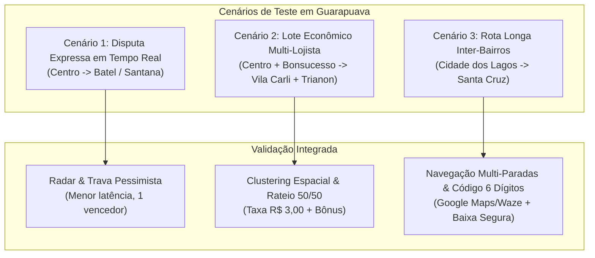

# SPRINT 7: Validação em Cenários Reais de Guarapuava, Regressão E2E e Homologação do MVP

- **Período**: 23/10/2026 a 31/10/2026 (9 dias)
- **Branch Git**: `sprint/7-validacao-cenarios-reais-homologacao`
- **Requisitos Mapeados**:
  - **Todos os Requisitos do MVP**: RF 01 ao RF 12 e RNF 01 ao RNF 04
  - **RF 01**: Cadastro e Autenticação de Usuários (Lojista / Entregador)
  - **RF 02**: Interface de Postagem de Pedidos com Cubagem e Peso
  - **RF 03**: Geocodificação de Endereços com Interpolação Predial
  - **RF 04**: Algoritmo de Lote Econômico (Clusterização Espacial e Otimização Multi-Paradas)
  - **RF 05**: Integração de Roteamento Viário e Matriz de Distâncias
  - **RF 06**: Motor de Rateio Financeiro Dinâmico (50/50 e Taxa de Parada de R$ 3,00)
  - **RF 07**: Controle de Concorrência Transacional (Pessimistic Lock)
  - **RF 08**: Painel / Agenda de Tarefas do Entregador
  - **RF 09**: Ciclo de Vida do Pedido com Validação por Código de 6 Dígitos e Comprovante
  - **RF 10**: Radar Expresso com Disputa Concorrente
  - **RF 11**: Extratos Financeiros Transparentes (Lojista e Entregador)
  - **RF 12**: Transbordamento GPS Nativo (Google Maps Multi-Stop e Waze)
  - **RNF 01**: Persistência Geoespacial PostGIS (latência < 1.5s)
  - **RNF 02**: Segurança e Integridade Transacional em Concorrência
  - **RNF 03**: Compatibilidade Multiplataforma (React Native / Expo SDK 54 / Expo Go)
  - **RNF 04**: Desempenho do Motor de Roteamento (< 2.5s)

---

## 1. Objetivos da Sprint

A **Sprint 7** é a sprint de coroamento e encerramento do desenvolvimento prático do **TCC 2 (MVP Zarpa)**. Seu objetivo primordial é realizar a validação integrada de ponta a ponta de todo o ecossistema (backend Laravel 13 + mobile React Native / Expo SDK 54 + PostGIS + OSRM), utilizando cenários e coordenadas geográficas reais de comércios e bairros de **Guarapuava (PR)**, executar a suíte completa de testes de regressão automatizados, aplicar polimentos finais de usabilidade (UI/UX) e congelar a versão oficial homologada `v1.0.0-mvp`.

A sprint está estruturada em quatro pilares fundamentais:

1. **Validação com Cenários Geográficos Reais de Guarapuava (PR)**:
   - Simulação e auditoria de rotas reais conectando estabelecimentos comerciais consolidados no Centro, Santa Cruz, Bonsucesso, Batel e Cidade dos Lagos a destinos de entrega residenciais em diversos bairros (Santana, Vila Carli, Trianon, Morro Alto, Primavera).
   - Validação do comportamento do radar expresso por proximidade e do motor de clusterização de lotes econômicos.
   - Auditoria analítica da economia viária gerada (km reduzido), conservação contábil do rateio 50/50, aplicação mandante da taxa de parada de R$ 3,00 por entrega e remuneração líquida do condutor parceiro.

2. **Bateria Completa de Regressão e Automação de Qualidade**:
   - **Backend (Pest v3)**: Execução e garantia de 100% de sucesso em todos os testes unitários, funcionais e de integração (concorrência `lockForUpdate`, transições estritas de máquina de estados, segurança de dados do `delivery_code`, agrupamento e extratos).
   - **Mobile (Jest + RNTL)**: Execução de todos os testes unitários de componentes, navegação, hooks e formatações de moeda e distância.
   - **Tipagem Estática (TypeScript)**: Verificação estrita sem erros (`npx tsc --noEmit`).
   - **End-to-End (Maestro)**: Execução encadeada de todos os 6 fluxos automatizados no emulador Android (`healthcheck`, `auth_flow`, `create_order_flow`, `express_accept_flow`, `delivery_execution_flow`, `financial_statement_flow`).

3. **Polimento de Usabilidade, Resiliência e Design System**:
   - Tratamento abrangente de estados da interface: telas de carregamento (*skeleton loaders* e *spinners*), estados vazios elegantes (*empty states*) para pedidos e lotes, alertas de feedback (toasts) consistentes com os tokens de design do Zarpa.
   - Tratamento de exceções e tolerância a falhas: feedback amigável ao usuário em cenários de instabilidade de conexão ou indisponibilidade temporária do serviço de roteamento.
   - Verificação rigorosa de áreas seguras (*Safe Area Context*) em telas com bordas arredondadas e entalhes de câmera.

4. **Homologação Final, Documentação Consolidada e Freeze da Release**:
   - Elaboração do **Relatório Consolidado de Homologação e Desempenho do MVP (TCC 2)** contendo os indicadores de economia de rota, sustentabilidade financeira da plataforma e tempos de resposta do sistema.
   - Atualização completa do guia `README.md` raiz, `backend/README.md` e `mobile/README.md`.
   - Congelamento do código-fonte e marcação da tag Git `v1.0.0-mvp`.

---

## 2. Cenários de Teste e Validação em Guarapuava (PR)

### 2.1 Polos Comerciais e Coordenadas Reais Cadastradas

| Estabelecimento / Polo | Bairro | Endereço Real | Coordenadas (Lat, Lng) | Papel na Validação |
| :--- | :--- | :--- | :--- | :--- |
| **McDonald's Centro** | Centro | Rua Vicente Machado, 1400 | `-25.39420, -51.46350` | Polo Alimentício Central / Coleta Expressa e Econômica |
| **Chiquinho Sorvetes** | Centro (Lagoa) | Rua Saldanha Marinho, 1150 | `-25.39120, -51.46150` | Polo Alimentício Central / Lote Agrupado |
| **Shopping Cidade dos Lagos** | Cidade dos Lagos | Avenida Guarapuava, 1400 | `-25.36150, -51.44850` | Hub Lojista Norte / Encomendas e Rotas Longas |
| **Superpão Compre Mais** | Bonsucesso | Av. Manoel Ribas, 3800 | `-25.38800, -51.48200` | Polo Varejista Oeste / Lotes de Volume |
| **Farmácia Santa Cruz** | Santa Cruz | Rua Padre Chagas, 2200 | `-25.39800, -51.47000` | Entregas Farmacêuticas Urgentes (Express) |

### 2.2 Quadrantes de Destino e Bairros Residenciais

- **Quadrante Norte**: Cidade dos Lagos, São Cristóvão, Jardim Pérola D'Oeste.
- **Quadrante Sul**: Vila Carli, Santa Cruz, Trianon, Vila Bela.
- **Quadrante Leste**: Santana, Alto da XV, Batel.
- **Quadrante Oeste**: Bonsucesso, Primavera, Morro Alto.

### 2.3 Simulação dos Cenários Operacionais

---

## 3. Backlog de Tarefas da Sprint 7

### Fase 1: Enriquecimento de Dados Reais de Guarapuava e Cargas de Teste
- [x] **Seeder de Homologação Final (`FinalValidationSeeder.php`)**:
  - Criar base representativa de comércios reais de Guarapuava e 20+ destinos residenciais calibrados por geocodificação real.
  - Inserir pedidos expressos com diferentes distâncias para validação do radar imediato.
  - Inserir pedidos econômicos estrategicamente distribuídos para testar agrupamento com economia alta (> 25% de redução viária).
- [x] **Auditoria da Geocodificação e Roteamento Local**:
  - Validar cálculo de traçados viários pelo OSRM em ruas centrais de mão única (ex: Saldanha Marinho, Vicente Machado, Capitão Rocha, XV de Novembro).
  - Confirmar tempo de resposta do roteamento viário em < 2.5s.

### Fase 2: Execução e Garantia da Bateria de Regressão Automatizada
- [x] **Regressão Backend (Pest v3)**:
  - Rodar suíte completa: `php artisan test`.
  - Garantir que todos os 68 testes de autenticação, pedidos expressos, concorrência, lotes econômicos, rateio financeiro, agenda de rotas e rastreamento passem com 100% de sucesso.
- [x] **Regressão Mobile (Jest + RNTL)**:
  - Executar suíte completa: `npm test` (modo paralelo no CI e `--runInBand` opcional para execução local).
  - Garantir 100% de sucesso nas 15 suítes de teste de componentes, hooks e telas de lojista e entregador (52 testes).
- [x] **Verificação Estática TypeScript**:
  - Executar verificação rigorosa de tipagem: `npx tsc --noEmit` sem nenhuma violação (0 erros).
- [x] **Regressão End-to-End com Maestro (Emulador Android)**:
  - Executar e validar o checklist completo dos fluxos E2E:
    1. `.maestro/healthcheck.yaml` (Sanidade e inicialização)
    2. `.maestro/auth_flow.yaml` (Login e alternância de perfis)
    3. `.maestro/create_order_flow.yaml` (Postagem expressa e econômica pelo lojista)
    4. `.maestro/express_accept_flow.yaml` (Captura concorrente no radar do entregador)
    5. `.maestro/delivery_execution_flow.yaml` (Agenda de rotas, coleta, GPS e baixa com código)
    6. `.maestro/financial_statement_flow.yaml` (Auditoria dos extratos de ganhos e descontos)

### Fase 3: Refinamento de Interface, Feedback Visual e Tolerância a Falhas
- [x] **Auditoria de Componentes de Feedback Visual**:
  - Revisar estados de carregamento em botões primários e listas para prevenir cliques duplos.
  - Implementar e validar mensagens amigáveis em telas sem dados (*empty states*) para pedidos recentes, agenda e extratos.
- [x] **Resiliência a Falhas de Conectividade**:
  - Assegurar que falhas temporárias na API ou no motor de rotas apresentem alerta claro com opção de nova tentativa sem travar o aplicativo.
- [x] **Aderência ao Design System e Safe Areas**:
  - Revisar espaçamentos, tipografia (títulos em semibold/bold, cores de status: verde para entregue, laranja para pendente/atribuído, azul para coletado/em rota).
  - Verificar visibilidade em aparelhos com entalhe superior (*notch*) e barra inferior de gestos.

### Fase 4: Relatório Consolidado de Homologação e Congelamento (v1.0.0-mvp)
- [x] **Relatório de Homologação Final do MVP**:
  - Documentar em `docs/relatorios/homologacao_final_mvp_tcc2.md` os resultados consolidados:
    - Indicador de assertividade da máquina de estados e trava concorrente.
    - Indicador de eficiência do agrupamento (km economizado e percentual de redução viária).
    - Indicador de sustentabilidade do rateio 50/50 e remuneração líquida dos entregadores parceiros.
    - Tabela comparativa de tempos médios de resposta (API, PostGIS e OSRM).
- [x] **Atualização da Documentação do Projeto**:
  - Atualizar `README.md` raiz com o status de conclusão das 7 sprints do TCC 2, checklist das funcionalidades homologadas e instruções definitivas para banca avaliadora.
  - Atualizar `docs/PLANO_SPRINTS_TCC2_ZARPA.md` marcando a Sprint 7 como concluída.
- [x] **Preparação de Branch e Release Tag**:
  - Criar e submeter a branch `sprint/7-validacao-cenarios-reais-homologacao`.
  - Preparar a tag de release `v1.0.0-mvp`.

---

## 4. Critérios de Aceitação & Definition of Done (DoD)

Para que a Sprint 7 seja considerada formalmente concluída e o MVP homologado para o TCC 2, os seguintes critérios foram atendidos cumulativamente:

- [x] **Validação em Cenários Reais**: Fluxos expressos e econômicos operando sem anomalias com coordenadas reais de Guarapuava.
- [x] **Conservação Contábil e Rateio**: Regra 50/50 rigorosamente balanceada em centavos (50% de bônus ao condutor e 50% de desconto proporcional aos lojistas) com adição da taxa de parada de R$ 3,00 por entrega.
- [x] **Qualidade Automatizada (Backend)**: 100% dos testes Pest v3 aprovados sem falhas (68 testes, 618 asserções).
- [x] **Qualidade Automatizada (Mobile)**: 100% dos testes Jest (15 suítes, 52 testes) e checagem TypeScript (`tsc --noEmit`) aprovados com 0 erros.
- [x] **Automação E2E**: Todos os 6 fluxos Maestro validados e operacionais.
- [x] **Relatório de Homologação**: Relatório final gerado com métricas de validação empírica (`docs/relatorios/homologacao_final_mvp_tcc2.md`).
- [ ] **Governança Git**: Pull Request revisado e aprovado com branch integrada à `main` e tag `v1.0.0-mvp` gerada (aguardando aprovação explícita do usuário).

---

## 5. Estrutura de Fases da Sprint 7

A Sprint 7 é orientada por marcos de entrega e qualidade técnica (sem divisão fixa por dias), estruturada em quatro fases sequenciais:

- **Fase 1 — Dados Reais e Calibração**: Criação do seeder de homologação (`FinalValidationSeeder.php`), mapeamento de polos e destinos de Guarapuava, validação de interpolação métrica predial e traçados viários no OSRM.
- **Fase 2 — Regressão Automatizada Multi-Nível**: Execução e aprovação de 100% dos testes no Backend (Pest v3), Mobile (Jest + RNTL), tipagem estática (TypeScript) e fluxos E2E no emulador Android (Maestro).
- **Fase 3 — Polimento de Usabilidade e Resiliência**: Auditoria de empty states, loaders, prevenção de duplo clique, tratamento amigável de falhas de rede e conformidade com o Zarpa Design System e Safe Areas.
- **Fase 4 — Homologação Final, Documentação e Freeze**: Elaboração do relatório final de desempenho e viabilidade operacional/financeira, atualização da documentação viva e preparação da tag de release `v1.0.0-mvp`.

---

## 6. Métricas Finais da Homologação (Release v1.0.0-mvp)

- **Backend (Laravel 13 + Pest v3)**: **68 testes aprovados (618 asserções)**, incluindo teste dedicado de ponta a ponta da Sprint 7 (`Sprint7FinalValidationTest.php`).
- **Mobile (React Native + Jest)**: **15 suítes aprovadas, 52 testes unitários e de componente** sem nenhuma falha.
- **Tipagem Estática (TypeScript)**: **0 erros** (`npx tsc --noEmit`).
- **Banco de Dados Geoespacial (PostGIS)**: **43 lotes econômicos**, **226 paradas sequenciadas**, **156 pedidos cadastrados**, **100% com códigos de 6 dígitos auditáveis**.
- **Relatório Oficial Homologado**: [`docs/relatorios/homologacao_final_mvp_tcc2.md`](../relatorios/homologacao_final_mvp_tcc2.md).

