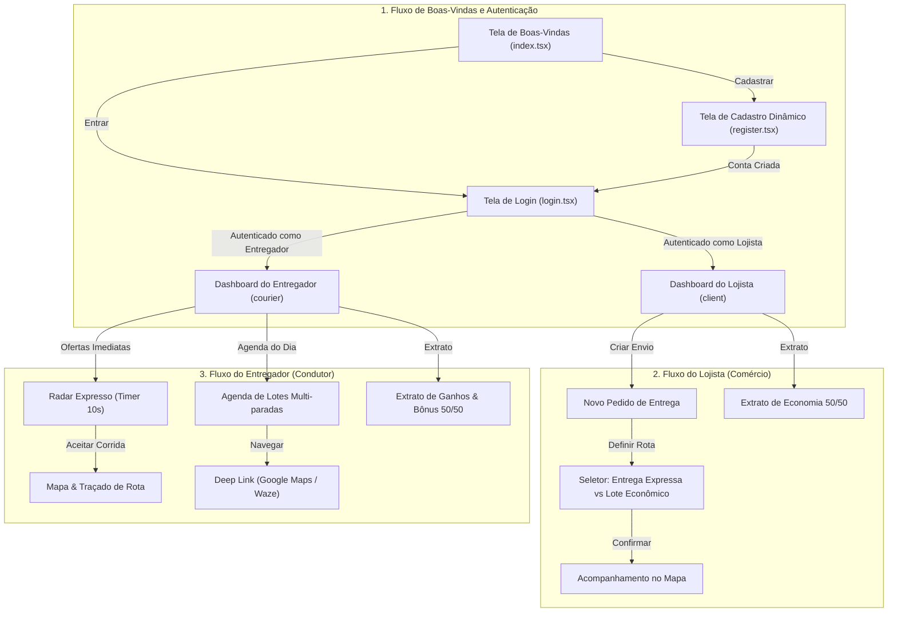
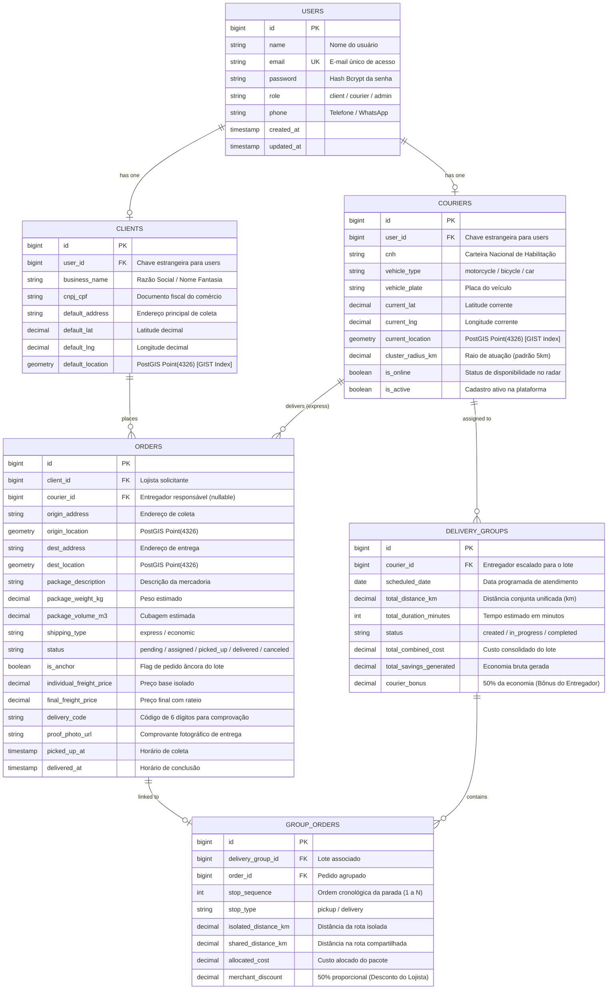

# 📱 ZARPA Mobile - Aplicativo Inteligente de Intermediação de Entregas Urbanas

> **Componente Curricular**: Desenvolvimento de Projetos para Dispositivos Móveis  
> **Curso**: Tecnologia em Sistemas para Internet | **Instituição**: UTFPR – Câmpus Guarapuava  
> **Autor**: Leonardo Tosin  
> **Orientador**: Prof. Dr. Andres Jessé Porfirio  
> **Projeto Integrado**: Trabalho de Conclusão de Curso 2 (TCC 2)  
> **Protótipo no Figma**: [zarpa-entregas (Figma UI/UX)](https://www.figma.com/design/TIzcx26iKkfJtdGsidStqD/zarpa-entregas?node-id=4-2&p=f)  
> **Repositório Público no GitHub**: [LeonardoTosinPR/Zarpa](https://github.com/LeonardoTosinPR/Zarpa)

---

## 📌 Sobre o App

O **Zarpa Mobile** é um aplicativo móvel multiplataforma (Android e iOS) desenvolvido com **React Native** e **Expo SDK 54**, voltado à intermediação inteligente de fretes urbanos no município de Guarapuava (PR). A plataforma conecta diretamente **Lojistas (Comércio Local)** a **Entregadores Autônomos (Couriers)**, eliminando intermediários predatórios e introduzindo um modelo inédito de **Lote Econômico com Rateio Dinâmico 50/50** baseado em otimização geoespacial.

O aplicativo oferece duas modalidades centrais de entrega:
1. **Entrega Expressa (On-Demand)**: Atendimento imediato e exclusivo com radar por proximidade geográfica e bloqueio pessimista de concorrência (`lockForUpdate()`), garantindo que apenas o primeiro entregador que aceitar a corrida assuma a rota.
2. **Lote Econômico (Rotas Compartilhadas)**: Agrupamento noturno automatizado de múltiplos pacotes compatíveis por proximidade de rota (PostGIS + OpenRouteService), repassando 50% da economia de quilometragem gerada como desconto aos lojistas e 50% como bônus financeiro de produtividade aos entregadores.

---

### 📋 Checklist de Funcionalidades do Projeto

Este checklist documenta a evolução contínua das funcionalidades nos checkpoints da disciplina:

#### 🚀 Funcionalidades Básicas (Prioritárias para o MVP)
- [x] **Setup do Monorepo & Infraestrutura Mobile**: Estrutura Expo SDK 54 compatível com Expo Go e emulador Android.
- [x] **Módulo de Atores e Autenticação Isolada**:
  - [x] Tela de Boas-Vindas com proposta de valor e acesso limpo de produção.
  - [x] Tela de Login unificada com validação de credenciais.
  - [x] Tela de Cadastro dinâmico especializado para Lojista (CNPJ/Razão Social) e Entregador (CNH/Veículo/Placa).
  - [x] Gerenciamento de sessão com `AuthContext` e tokens seguros via `expo-secure-store`.
  - [x] Navegação condicional protegida por papéis (`(client)` e `(courier)`), além de **Painel Administrativo Master (`admin.tsx`)**.
- [x] **Postagem de Pedidos & Geocodificação (Lojista - Sprint 2)**:
  - [x] Formulário de criação de entregas com ponto de coleta flexível (GPS, loja ou digitação).
  - [x] Geocodificação de endereços em coordenadas com autocomplete, debounce e interpolação métrica predial.
  - [x] Seletor visual de modalidade de frete (*Entrega Expressa* vs *Lote Econômico*).
  - [x] Visualização prévia da rota no mapa interativo com OpenStreetMap (`expo-leaflet`).
- [x] **Radar Expresso & Disputa Concorrente (Entregador - Sprint 3)**:
  - [x] Tela de Radar de ofertas imediatas com contagem regressiva de 10 segundos (`(courier)/express-radar.tsx`).
  - [x] Ação rápida "Aceitar Corrida" com feedback anti-colisão transacional (`HTTP 409 Conflict`).
  - [x] Ação "Recusar Corrida" persistida no backend (`OrderRejection`), ocultando o chamado da listagem do condutor.
  - [x] Raio de atuação customizável via modal combo-box (1 a 50 km) e tipo de transporte em combo-box no Perfil (`(courier)/profile.tsx`).
  - [x] Alteração de foto de perfil direto da galeria do aparelho celular (`expo-image-picker`) tanto para entregadores quanto para lojistas.
  - [x] Acesso direto à tela de perfil tocando no avatar do cabeçalho global (`Header.tsx`) de qualquer tela.
  - [x] Autocomplete de endereços com priorização de polos locais (UTFPR, Unicentro Santa Cruz, Unicentro CEDETEG, Shopping) exibindo nome do local em destaque e endereço completo.
  - [x] Renderização de mapas com **Expo-Leaflet + OpenStreetMap via WebView** (conforme orientação acadêmica - componente `MyMap` / repositório `pdm-ts-maps-leaflet`): arquitetura padronizada com `expo-leaflet` e `react-native-webview` consumindo a API aberta da OpenStreetMap Foundation (OSM), eliminando totalmente a dependência do SDK pago do Google Maps e incompatibilidades da New Architecture/Fabric no Android, com marcadores customizados, traçado de rota OSRM, raio de cobertura do radar express e suporte cross-platform.
  - [x] Painel de Telemetria GPS em Tempo Real em tela (`(courier)/dashboard.tsx` e `express-radar.tsx`): exibição visual de latitude, longitude, polo (Guarapuava), status de conexão ("GPS Ativo no Dispositivo") e sincronização contínua com a base PostGIS do backend Docker via ADB reverse (`tcp:8000`).
- [x] **Agenda de Lotes Econômicos & Execução Operacional (Sprint 4 & 6)**:
  - [x] Visualização da agenda de paradas sequenciais de coleta e entrega (`route-agenda.tsx`) e **Bônus Unificado** (Taxa de Parada R$ 3,00 + Rateio 50%) nas telas de Lotes e Agenda.
  - [x] Transições manuais de status do pedido (*Coletado*, *Entregue*) com validação obrigatória de **Comprovante de Entrega** (Código de 6 dígitos `delivery_code` gerado para o lojista ou Foto Comprobatória via `expo-image-picker`).
  - [x] Transbordamento direto de rota (*Deep Linking*) para Google Maps e Waze tanto em **rota única com waypoints para todas as paradas do lote** (`openMultiStopNavigation`) quanto nas **entregas expressas** (`active-delivery.tsx`).
  - [x] Timeline vertical de rastreamento do pedido com exibição do código de segurança de 6 dígitos e link público do comprovante para o lojista (`(client)/orders.tsx`).
  - [x] Painel Administrativo Master (`admin.tsx`) com disparo manual do Lote Econômico Noturno e auditoria de usuários e pedidos.
- [x] **Extratos Financeiros com Rateio Dinâmico 50/50 (Sprint 5)**:
  - [x] Painel do Lojista exibindo o desconto obtido e economia acumulada (`(client)/financial.tsx`).
  - [x] Painel do Entregador detalhando faturamento base, taxa de parada e bônus de rateio por lote (`(courier)/financial.tsx`).

#### 🔮 Funcionalidades Adicionais (Trabalhos Futuros / Pós-MVP)
- [ ] Notificações Push nativas em tempo real (Firebase Cloud Messaging / Expo Notifications).
- [ ] Rastreamento contínuo em tempo real com WebSockets / SSE do entregador em trânsito.
- [ ] Integração com gateway de pagamentos instantâneos (PIX automático).
- [ ] Sistema de avaliação mútua por estrelas entre lojistas e entregadores.

---

## 🎨 Protótipos de Tela

Todo o Design System, componentes visuais e fluxos de usuário foram prototipados no **Figma**:

🔗 **Link Público de Visualização no Figma**:  
👉 [**zarpa-entregas (Design System & Telas)**](https://www.figma.com/design/TIzcx26iKkfJtdGsidStqD/zarpa-entregas?node-id=4-2&p=f)

---

### 📱 Mapa e Fluxos de Telas do Aplicativo



---

### 🖼️ Principais Interfaces Modeladas no Figma

| Tela / Módulo | Descrição Visual e Operacional |
| :--- | :--- |
| **Boas-Vindas & Acesso** | Identidade visual da marca **⚡ Zarpa**, proposta de valor e acesso direto ao fluxo de autenticação e cadastro. |
| **Login & Cadastro** | Validações com feedback de erro em tempo real e formulário condicional (CNPJ/Razão Social vs CNH/Veículo/Placa). |
| **Novo Pedido** | Inputs com autocomplete de endereços em Guarapuava, descrição da carga e peso total com cálculo de frete. |
| **Modo de Entrega** | Seleção entre **Entrega Expressa** (prioridade direta) e **Rota Econômica** (com rateio inteligente). |
| **Agenda de Rotas** | Timeline com cards ordenados de coleta e entrega, rota GPS unificada, comprovação por código de 6 dígitos/foto e bônus unificado. |
| **Radar Expresso** | Card com contagem regressiva visual de 10s, ganho líquido, distância e botão de aceite rápido. |

---

## 🗄️ Modelagem do Banco de Dados

### Estratégia de Arquitetura e Persistência
O sistema adota uma arquitetura em camadas cliente-servidor desacoplada:
1. **Persistência Remota Geoespacial**:
   - Banco de dados relacional **PostgreSQL 16** com a extensão geoespacial **PostGIS (`postgis/postgis:16-3.4`)** ativada.
   - Gerenciado por uma API RESTful em **Laravel 13 (PHP 8.3+)** com autenticação baseada em tokens via **Laravel Sanctum**.
   - Armazenamento de geometrias espaciais em formato nativo `Point (SRID 4326)` com indexação espacial acelerada por árvores **`GIST`** para consultas de proximidade (`ST_DWithin`).
2. **Persistência Local no Aplicativo Mobile**:
   - Armazenamento encriptado no dispositivo móvel via **`expo-secure-store`** para tokens de sessão (Sanctum Bearer Token) e dados do perfil autenticado.
   - Gerenciamento de cache e revalidação de consultas de rede em memória via **`@tanstack/react-query`**.

---

### 📊 Diagrama Entidade-Relacionamento (DER Lógico)



---

## 📅 Planejamento de Sprints

O cronograma de desenvolvimento está estruturado em **8 sprints iterativas** ao longo do período de **25/08/2026 a 31/10/2026 (~9,5 semanas)**:

| Sprint | Período | Duração | Branch Git Obrigatória | Requisitos Mapeados | Foco Temático Principal | Status |
| :--- | :--- | :--- | :--- | :--- | :--- | :--- |
| **Sprint 0** | 25/08 a 01/09/2026 | 1,1 semana (8 dias) | `sprint/0-setup-monorepo-infra-testes` | RNF 01, RNF 03 | Monorepo, Docker PostgreSQL/PostGIS, Laravel 13, Expo SDK 54, Pest, Jest e Maestro | **✅ Concluída** |
| **Sprint 1** | 02/09 a 09/09/2026 | 1,1 semana (8 dias) | `sprint/1-auth-perfis-atores` | RF 01, RNF 03 | Autenticação Sanctum, Perfis Lojista/Entregador/Admin, SecureStore, Dashboards e CLI `run.ps1` | **✅ Concluída** |
| **Sprint 2** | 10/09 a 17/09/2026 | 1,1 semana (8 dias) | `sprint/2-postagem-geocodificacao-pedidos` | RF 02, RF 03, RNF 01 | Postagem de Pedidos, Geocodificação OSRM em Guarapuava e Mapa Interativo | **✅ Concluída** |
| **Sprint 3** | 18/09 a 25/09/2026 | 1,1 semana (8 dias) | `sprint/3-fluxo-expresso-concorrencia` | RF 05, RF 07, RF 10, RNF 02 | Radar Expresso On-Demand com timer de 10s e Trava Pessimista anti-conflito (`lockForUpdate`) | **✅ Concluída** |
| **Sprint 4** | 26/09 a 04/10/2026 | 1,3 semana (9 dias) | `sprint/4-lote-economico-agrupamento` | RF 04, RF 05, RNF 01 | Lote Econômico Noturno (Batch), Clusterização Geoespacial e Rotas Multi-paradas OSRM | **✅ Concluída** |
| **Sprint 5** | 05/10 a 13/10/2026 | 1,3 semana (9 dias) | `sprint/5-rateio-dinamico-extratos` | RF 06, RF 11 | Motor de Rateio Financeiro 50/50, Extratos Transparentes e Taxa de Parada (R$ 3,00) | **✅ Concluída** |
| **Sprint 6** | 14/10 a 22/10/2026 | 1,3 semana (9 dias) | `sprint/6-execucao-rotas-status-navegacao` | RF 08, RF 09, RF 12 | Agenda de Rotas Operacionais, Ciclo de Vida do Pedido com Comprovante e Transbordamento GPS | **✅ Concluída** |
| **Sprint 7** | 23/10 a 31/10/2026 | 1,3 semana (9 dias) | `sprint/7-validacao-cenarios-reais-homologacao` | Todos (RF 01 a 12, RNF 01 a 04) | Validação com Rotas Reais de Guarapuava, Regressão E2E Maestro e Congelamento do MVP | **🔄 Em Andamento** |

---

## Atualizações desde o último checkpoint

Esta seção atende aos requisitos de entrega do **Checkpoint 2 da disciplina de Dispositivos Móveis 2**, consolidando a evolução da arquitetura mobile, os recursos aplicados e as boas práticas de desenvolvimento adotadas:

### 📱 Recursos dos Módulos Anteriores Aplicados na Aplicação

1. **Roteamento Baseado em Arquivos com Expo Router v4 (`expo-router`)**:
   - Organização em grupos de rotas com layouts aninhados e isolamento de papéis (`app/(client)/_layout.tsx` para lojistas e `app/(courier)/_layout.tsx` para entregadores).
   - Navegação por abas inferiores (`Tabs`) estilizadas com `Ionicons`, mantendo persistência de estado e animações de transição nativas.
   - Passagem de parâmetros de rota fortemente tipados via hook `useLocalSearchParams<{ orderId: string }>()`.
   - Proteção declarativa de rotas e redirecionamento através do `AuthContext`.

2. **Gestão Segura de Insets com Expo Safe Area Context (`react-native-safe-area-context`) e Foco no Android**:
   - Em conformidade com o feedback do orientador e a documentação oficial da Expo ([Safe Area Context](https://docs.expo.dev/versions/latest/sdk/safe-area-context/)), a aplicação adotou o `<SafeAreaProvider>` na raiz do app (`app/_layout.tsx`).
   - Implementação do hook centralizado `useAppInsets()` (`src/hooks/useAppInsets.ts`), computando dinamicamente `Math.max(insets.top, Platform.OS === 'android' ? (StatusBar.currentHeight || 24) : 0)` e `insets.bottom` para garantir que a Status Bar do Android e notches nunca sobreponham headers, títulos, cards flutuantes de mapas (`app/(courier)/express-radar.tsx`, `app/(courier)/active-delivery.tsx`) ou barras de navegação globais (`src/components/Header.tsx`).

3. **Design System Centralizado & Governança de UI**:
   - Centralização de tokens visuais em `src/constants/theme.ts` (`COLORS`, `FONTS`, `SPACING`, `RADIUS`, `SHADOWS`), eliminando números mágicos e cores hexadecimais dispersas no código.
   - Padronização visual de cards, cabeçalhos, indicadores de status e modais para Lojistas, Entregadores e Administração.

4. **Simplificação Ergonômica de UX (Dashboards Focados e Remoção de Atalhos Redundantes)**:
   - Remoção dos botões de login rápido de homologação das telas de Boas-Vindas e Login.
   - Simplificação dos Dashboards operacionais (`(courier)/dashboard.tsx` e `(client)/dashboard.tsx`) para focar apenas nos KPIs essenciais de leitura rápida, concentrando a navegação nas abas inferiores.
   - O logout reside exclusivamente nas telas de Perfil (`(courier)/profile.tsx` e `(client)/profile.tsx`), sob a seção de configurações da conta e protegido por confirmação prévia com `Alert.alert`.

5. **Armazenamento Criptografado de Sessão (`expo-secure-store`)**:
   - Persistência criptografada de tokens de autenticação (Sanctum) e metadados de perfil no hardware do dispositivo (Keychain no iOS e KeyStore no Android), permitindo login persistente seguro.

6. **Telemetria de Localização e Permissões (`expo-location`)**:
   - Captura contínua de coordenadas geográficas (`watchPositionAsync` / `getCurrentPositionAsync`) para sintonização dinâmica de pedidos no radar espacial.

7. **Mapeamento Geoespacial sem Custos com OpenStreetMap (`expo-leaflet` + `react-native-webview`)**:
   - Renderização de mapas vetoriais interativos e polylines de rotas sem dependência de APIs proprietárias ou faturamento com cartão de crédito do Google Maps.

---

## Documentação de Módulos e Boas Práticas de Componentes

Todos os componentes customizados da aplicação residem no diretório [`src/components/`](src/components/) e foram concebidos sob os conceitos fundamentais da aula **"Boas práticas para a criação de componentes reutilizáveis"**:

### 🎯 Princípios e Conceitos Aplicados

1. **Princípio da Responsabilidade Única (Single Responsibility Principle - SRP)**:
   - Cada componente possui um propósito estrito e bem definido. Por exemplo, o componente `Button` é responsável exclusivamente por renderizar o gatilho de ação, gerenciar seu estado de carregamento (`loading`) e fornecer feedback tátil, sem incorporar lógica de negócio ou chamadas de rede.

2. **Componentes Puros de Apresentação (*Presentational / Dumb Components*)**:
   - Os componentes de `src/components/` são desacoplados do estado global da aplicação e de APIs REST. Todo o comportamento é controlado via `props` (`title`, `value`, `error`, `variant`) e eventos comunicados via callbacks (`onPress`, `onChangeText`, `onMapClicked`), viabilizando reutilização universal e testes unitários determinísticos.

3. **Tipagem Estrita com TypeScript**:
   - Todas as interfaces de propriedades são exportadas e documentadas (ex: `ButtonProps`, `InputProps`, `HeaderProps`, `RoleSelectorProps`, `MyMapProps`, `RouteMapPreviewProps`), garantindo autocompletion no editor e prevenção de erros em tempo de compilação.

4. **Composição e Extensibilidade (*Children & Slots*)**:
   - Em vez de criar múltiplos componentes rígidos, adotou-se o padrão de composição. O componente `Input` aceita slots opcionais para `leftIcon` e `rightIcon`, além de herdar nativamente todas as propriedades do `TextInputProps` do React Native.

5. **Acessibilidade e Feedback de Toque**:
   - Uso consistente de `activeOpacity={0.7}`, `accessibilityRole`, estados de desabilitado visualmente claros (`opacity: 0.5`) e identificadores para testes automatizados (`testID`).

6. **Encapsulamento de Estilos com Design Tokens**:
   - Uso de `StyleSheet.create` para impedir recriação de objetos de estilo em cada renderização, consumindo exclusivamente constantes de `src/constants/theme.ts`.

### 📋 Catálogo de Componentes em `src/components/`

| Componente | Arquivo | Responsabilidade Principal | Boas Práticas Demonstradas |
| :--- | :--- | :--- | :--- |
| **`Button`** | [`Button.tsx`](src/components/Button.tsx) | Botão interativo de ação | Suporte a 4 variantes visuais (`primary`, `secondary`, `outline`, `danger`), feedback tátil, spinner integrado (`ActivityIndicator`) e bloqueio de toques múltiplos em loading. |
| **`Input`** | [`Input.tsx`](src/components/Input.tsx) | Campo de digitação de formulário | Label integrado, ícones compostos (`leftIcon`/`rightIcon`), feedback de foco com borda reativa (`COLORS.borderFocus`) e renderização condicional de mensagens de erro. |
| **`Header`** | [`Header.tsx`](src/components/Header.tsx) | Barra superior de navegação | Integração com `useAppInsets` (Safe Area Android/iOS), logotipo institucional, avatar dinâmico com inicial do usuário e indicador de papel colorido. |
| **`RoleSelector`** | [`RoleSelector.tsx`](src/components/RoleSelector.tsx) | Seletor de perfil (Lojista / Entregador) | Alternância de estado atômico com realce de borda e cores temáticas distintas para cada ator. |
| **`MyMap`** | [`MyMap.tsx`](src/components/MyMap.tsx) | Mapa base em OpenStreetMap | Componente de mapa livre baseado no modelo do orientador (Prof. Andres), suporte a camadas de azulejos OSM, marcadores SVG dinâmicos e centróide em Guarapuava. |
| **`RouteMapPreview`** | [`RouteMapPreview.tsx`](src/components/RouteMapPreview.tsx) | Visualizador de rotas e polylines | Renderização de rotas reais com OSRM, marcadores de coleta/entrega, raio circular de cobertura de radar em km e modo sem bordas para tela cheia. |
| **`DeliveryProofModal`** | [`DeliveryProofModal.tsx`](src/components/DeliveryProofModal.tsx) | Modal obrigatório de comprovação de entrega | Abas para Código de 6 dígitos (`delivery_code`) ou Foto (`expo-image-picker` câmera/galeria), validação de dígitos e callback tipado `onSubmit`. |
| **`DeliveryCodeBanner`** | [`DeliveryCodeBanner.tsx`](src/components/DeliveryCodeBanner.tsx) | Banner do código de segurança de 6 dígitos | Exibição destacada do `delivery_code` exclusivo gerado no pedido com dica contextual para o lojista e na timeline de rastreamento. |
| **`ExternalGpsButton`** | [`ExternalGpsButton.tsx`](src/components/ExternalGpsButton.tsx) | Gatilho de transbordamento para GPS externo | Suporte a 3 variantes (`card`, `secondary`, `compact`) para abrir rotas completas ou paradas no Google Maps / Waze. |
| **`OrderStatusBadge`** | [`OrderStatusBadge.tsx`](src/components/OrderStatusBadge.tsx) | Badges semânticos de status e modalidade | Componentes `OrderStatusBadge` e `OrderModalityBadge` centralizando cores e rótulos de status (`Pendente`, `Atribuído`, `Em Rota`, `Entregue`, `Cancelado`) e tipo (`Expressa` / `Econômica`). |
| **`EmptyState`** | [`EmptyState.tsx`](src/components/EmptyState.tsx) | Card padronizado de lista vazia | Ícone customizável do `Ionicons`, título, descrição e botão de ação primária opcional (`actionLabel` + `onAction`). |

---

## 🛠️ Stack Tecnológica Mobile

| Categoria | Tecnologia / Biblioteca | Finalidade no Projeto |
| :--- | :--- | :--- |
| **Framework Base** | [React Native](https://reactnative.dev/) (0.76+) | Criação de interface nativa multiplataforma Android/iOS |
| **Tooling & Runtime** | [Expo SDK 54](https://expo.dev/) (compatível com Expo Go) | Runtime moderno de desenvolvimento e acesso a APIs nativas |
| **Roteamento** | [Expo Router (v4)](https://docs.expo.dev/router/introduction/) | Roteamento baseado em arquivos (*file-based routing*) |
| **Linguagem** | [TypeScript](https://www.typescriptlang.org/) (5.x) | Tipagem estrita de contratos de dados e componentes |
| **Estado & Cache API**| [@tanstack/react-query](https://tanstack.com/query/latest) + [Axios](https://axios-http.com/) | Cache de requisições, mutações otimistas e sincronização |
| **Armazenamento Seguro**| `expo-secure-store` | Persistência criptografada de tokens Sanctum |
| **Mapas & GPS** | `expo-leaflet` + `react-native-webview` + `expo-location` | Renderização de mapas livres OpenStreetMap (OSM), polylines OSRM e GPS |
| **Navegação Externa** | `expo-linking` | Deep linking nativo para Google Maps (`geo:`) e Waze (`waze://`) |
| **Testes Unitários** | [Jest](https://jestjs.io/) + [React Native Testing Library](https://callstack.github.io/react-native-testing-library/) | Testes de componentes, hooks e fluxos de tela |
| **Testes End-to-End** | [Maestro](https://maestro.mobile.dev/) | Automação E2E em linguagem declarativa YAML |

---

## 📂 Estrutura de Diretórios do Módulo Mobile

```
mobile/
├── app/                          # Rotas e Telas do Aplicativo (Expo Router)
│   ├── _layout.tsx               # Root Layout com Provedores Globais (Auth, Theme, React Query)
│   ├── index.tsx                 # Tela de Boas-Vindas e Redirecionamento de Sessão
│   ├── login.tsx                 # Tela de Login de usuários
│   ├── register.tsx              # Tela de Cadastro dinâmico (Lojista / Entregador)
│   ├── admin.tsx                 # Painel Administrativo Master e execução manual do Lote Noturno
│   ├── (client)/                 # Grupo de rotas protegidas do Lojista
│   │   ├── _layout.tsx           # Layout com Tabs da área do Lojista
│   │   ├── dashboard.tsx         # Dashboard resumido de KPIs do comércio
│   │   ├── create-order.tsx      # Formulário de postagem com mapa e cotação de frete
│   │   ├── orders.tsx            # Gestão, código de entrega de 6 dígitos e timeline de rastreamento
│   │   ├── financial.tsx         # Extrato de economia cooperativa 50/50
│   │   └── profile.tsx           # Perfil e configurações do comércio com logout
│   └── (courier)/                # Grupo de rotas protegidas do Entregador
│       ├── _layout.tsx           # Layout com Tabs inferiores
│       ├── dashboard.tsx         # Dashboard resumido com status de turno, ganhos e telemetria GPS
│       ├── express-radar.tsx     # Radar Expresso On-Demand com mapa borderless e safe area
│       ├── economic-batches.tsx  # Consulta de lotes econômicos com Bônus Unificado
│       ├── route-agenda.tsx      # Agenda operacional sequenciada, rota GPS única e validação de código/foto
│       ├── active-delivery.tsx   # Entrega expressa ativa com GPS externo e validação de código/foto
│       ├── financial.tsx         # Extrato de ganhos brutos, bônus de lote e taxa de parada
│       └── profile.tsx           # Perfil do Entregador, CNH, raio de atuação e logout
├── src/
│   ├── components/               # Componentes UI (Header, Button, Input, MyMap, RouteMapPreview)
│   ├── constants/                # Constantes do Design System (theme.ts: cores, fontes, sombras)
│   ├── context/                  # Contextos globais (AuthContext.tsx)
│   ├── hooks/                    # Hooks reutilizáveis (useAppInsets.ts para Safe Area Android/iOS)
│   ├── screens/                  # Telas compartilhadas (AdminPanelScreen.tsx)
│   ├── services/                 # Clientes HTTP (api, orderService, courierService, financialService, adminService)
│   ├── types/                    # Contratos de tipos TypeScript
│   └── utils/                    # Funções utilitárias (navigationLauncher, decodePolyline)
├── assets/                       # Ícones, splash screens e marcadores de mapa
├── __tests__/                    # Suíte de testes unitários com Jest e RNTL (15 suítes / 52 testes)
├── app.json                      # Configurações do Expo
├── jest.config.js                # Configuração do Jest
├── package.json                  # Dependências e scripts npm
└── tsconfig.json                 # Configurações do TypeScript
```

---

## ⚡ Guia de Execução e Testes

### 🚀 Inicialização Rápida via CLI Unificado (Recomendado)
Na raiz do projeto (`/dados/tosin/Zarpa`):
- **PowerShell**:
  ```powershell
  .\run.ps1 dev
  ```
- **Bash / Linux**:
  ```bash
  ./run.sh dev
  ```

### 📱 Execução Manual do Mobile
```bash
cd mobile
npm install
npx expo start
```
- Pressione **`a`** no terminal para executar no **Emulador Android**;
- Ou abra o app **Expo Go** no smartphone físico e escaneie o QR Code.

### 🧪 Execução dos Testes Automatizados
```bash
cd mobile
npm test -- --runInBand
```

Resultados da suíte de testes unitários e de componentes:
```text
PASS __tests__/EconomicBatch.test.tsx
PASS __tests__/RouteAgenda.test.tsx
PASS __tests__/ActiveDelivery.test.tsx
PASS __tests__/FinancialStatement.test.tsx
PASS __tests__/ExpressRadar.test.tsx
PASS __tests__/CreateOrder.test.tsx
PASS __tests__/CourierProfile.test.tsx
PASS __tests__/AuthScreens.test.tsx
PASS __tests__/AdminPanel.test.tsx
PASS __tests__/OrderTracking.test.tsx
PASS __tests__/Orders.test.tsx
PASS __tests__/App.test.tsx
PASS __tests__/RoleSelector.test.tsx
PASS __tests__/MyMap.test.tsx
PASS __tests__/Polyline.test.ts

Test Suites: 15 passed, 15 total
Tests:       52 passed, 52 total
Snapshots:   0 total
```
```
